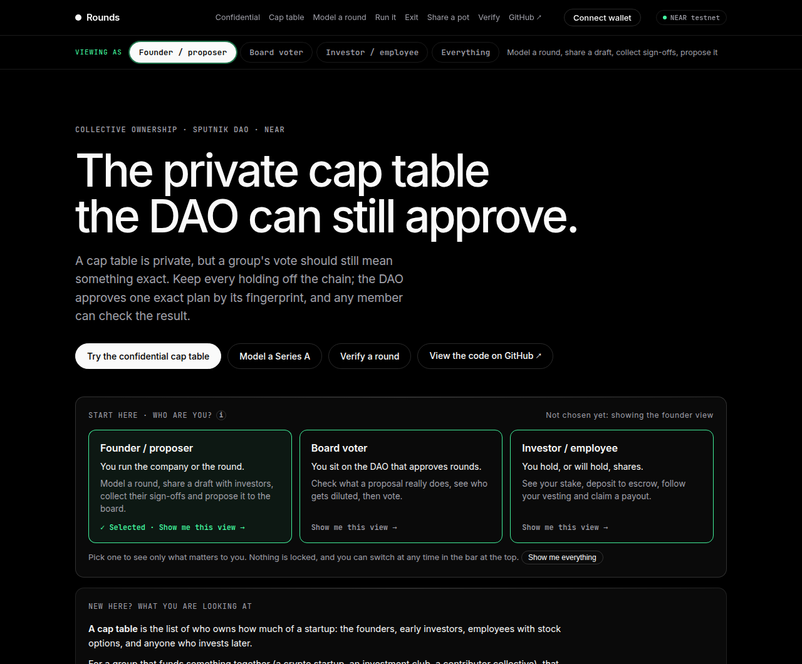
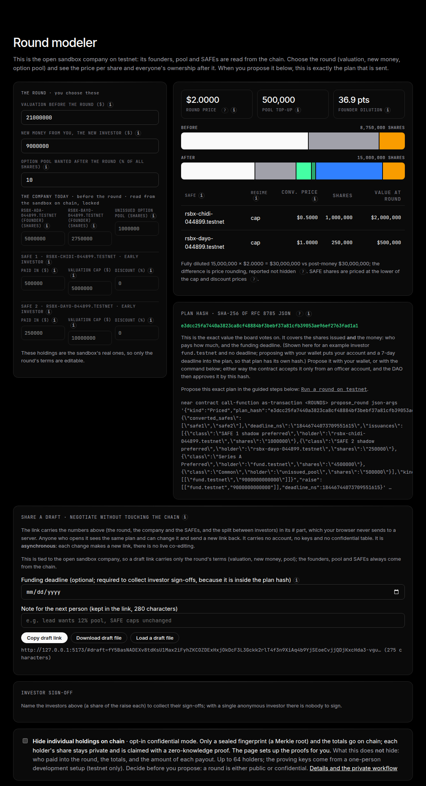
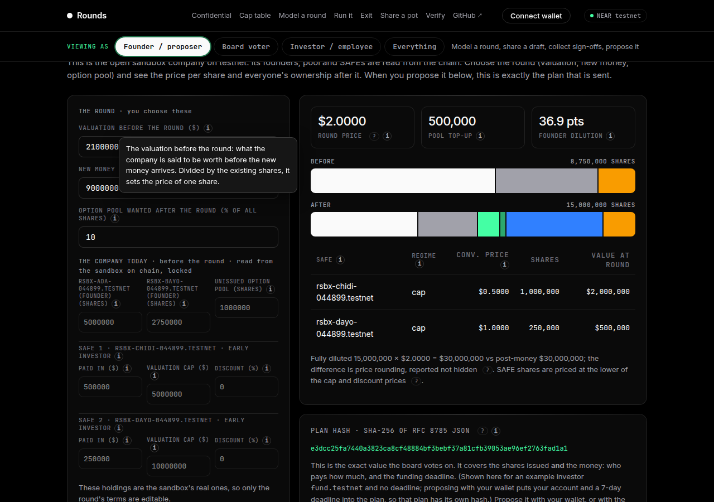
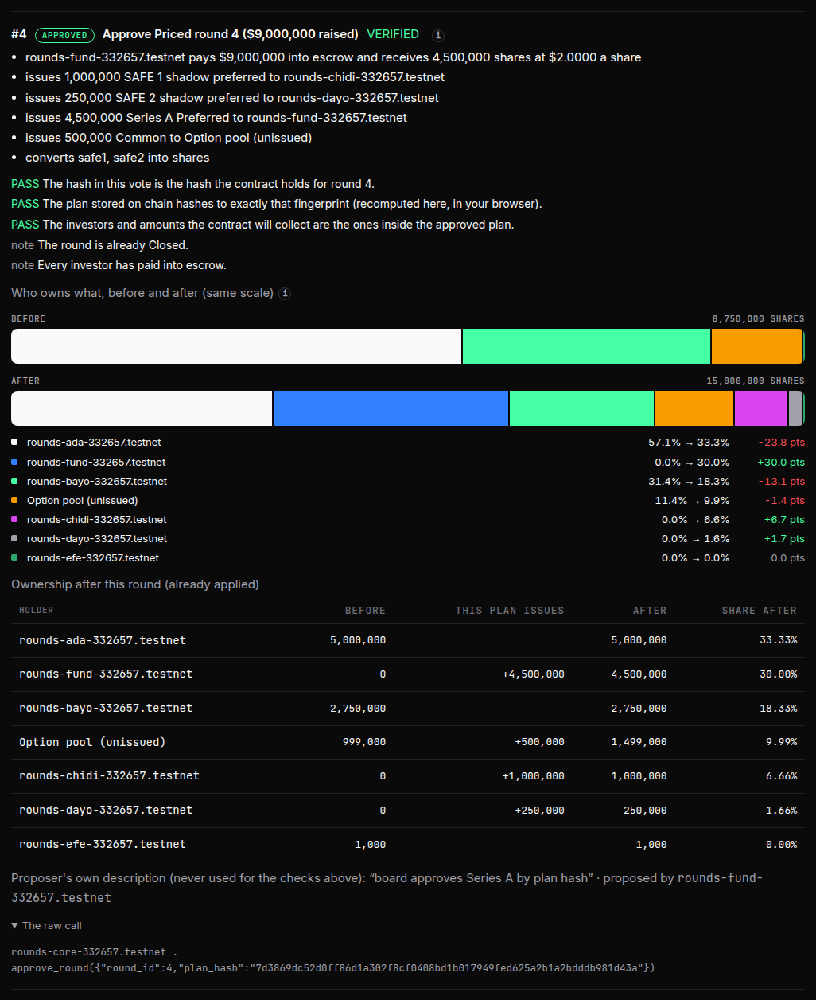
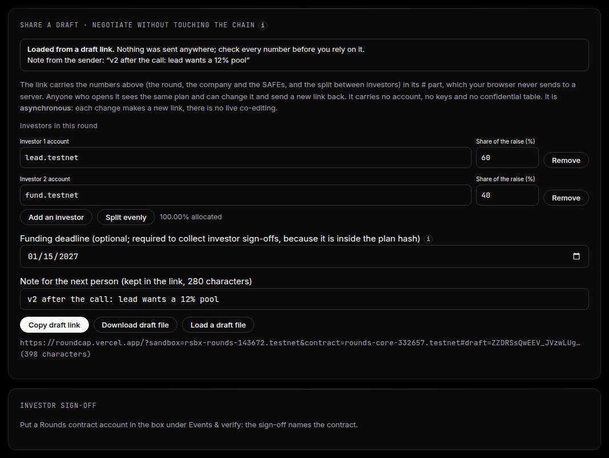
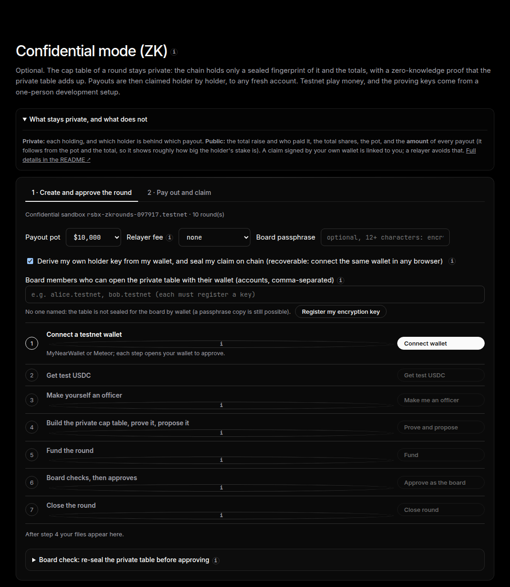
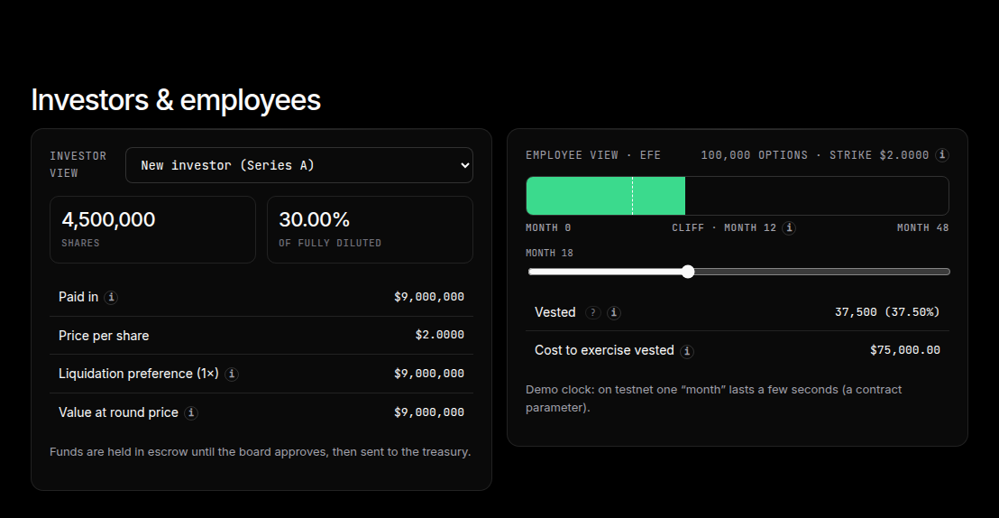

# Rounds — a confidential cap table that a Sputnik DAO approves to the exact number

> **Not legal or financial advice.** Rounds is a model and a **NEAR testnet demo**, not a securities offering, and claims no legal validity for any instrument. All money is a test token with no value. Built at NEAR HACKATHON (Nov 2026).

**Live app: https://roundcap.vercel.app** (NEAR testnet, play money; it reads the chain directly, nothing runs on a server) · **Code:** https://github.com/samuel025/Rounds

**In 30 seconds.** A real cap table is private, but a group that decides things with a Sputnik DAO still needs its vote to mean something exact. Rounds does both. Every change (who puts in how much, who gets how many shares, who is paid what) is an exact plan with a SHA-256 fingerprint; the money waits in escrow; the DAO votes on the fingerprint; and the contract only runs a plan that hashes to what was approved.

- **Confidential mode (zero-knowledge, optional):** the chain stores only a sealed fingerprint of the cap table plus a Groth16 proof that it adds up. No holding appears on chain, the board checks the private table before approving, and a holder claims a payout with a proof that does not say which row is theirs, paid to a brand-new account through a relayer. Holder keys can come from a wallet signature, so a lost file is no longer a lost claim, and the board's private table can be sealed for its members' wallets ([docs/WALLET-KEYS.md](docs/WALLET-KEYS.md)).
- **Working together:** role views (Founder, Board voter, Investor), draft links to negotiate a round without touching the chain, investor sign-offs on each holder's own row, and before/after ownership bars on every board vote.
- **Transparent mode (default):** the full feature set with holdings on chain: priced rounds, converting SAFEs, vesting, exits, SAFT token conversion, and a shared pot paid pro rata. Anyone can recompute any plan in their own browser (**Verify**), and failed attacks are on chain for anyone to re-check.

## See it in 60 seconds

Screenshots of the live app (NEAR testnet), taken by `scripts/screenshots.mjs`; nothing here is mocked.

**Pick who you are.** A "Who are you?" chooser at the top (and a "Viewing as" bar that stays on screen) sets the view: Founder, Board voter or Investor each see only what they need, and the technical proof sits behind a toggle. Nothing is locked.

**Model a round, then see the exact plan the board votes on.** Change the valuation, new money or option pool and watch the price per share and everyone's ownership update; every number comes from the exact-integer engine.

**Hints for anyone who has never seen a cap table.** Every term has a small ⓘ that explains it in plain words: valuation, option pool, SAFE, price per share, plan hash, escrow, the board and more. Hover, tap or tab to it.

**A board member sees who is diluted before voting.** Each Sputnik DAO proposal is decoded and its hash re-checked in the browser, with a before/after ownership chart and the change in points per holder.

**Negotiate in a link, then collect sign-offs.** A draft link carries the round's terms (no server, no account); each investor can sign off on their own row of the exact plan before it goes to the board.

**Confidential mode.** The cap table stays off the chain behind a zero-knowledge proof; holder keys can come from a wallet signature, and the board's private table can be sealed for its members' wallets.

**An investor's own view.**

## Start here (judges and agents: this file is enough)

**Needs:** Node 20 or newer and Python 3. Nothing else: no account, no key, no wallet and no money for steps 1 to 7. All commands run from the repository root. Testnet only, play money.

| # | Run | Takes | You should see |
|---|---|---|---|
| 1 | `git clone https://github.com/samuel025/Rounds && cd Rounds && npm install` | ~10 s | `added … packages` |
| 2 | `make test` | ~30 s | Vitest: `Tests  92 passed`, then `"mismatches": 0` from the Python reference (1,000 random scenarios agree with the TypeScript engine) |
| 3 | `npx vitest run test/zk.test.ts` | ~15 s | `Tests  10 passed`: the confidential mode's real circuits accept valid proofs and refuse every forged one |
| 4 | `make replay` | a few seconds, offline | the committed testnet run rebuilt from its events; last line `PASS summary: … 0 failed` (<!--n:replay.checks-->11<!--/n--> checks) |
| 5 | `make verify-onchain` | under a minute, needs network | re-reads the live testnet contract and its failed attack transactions; last line `PASS summary: … 0 failed` (<!--n:verify_onchain.checks-->31<!--/n--> checks; a `FAIL` line means a mismatch, or the public RPC was unreachable: run it again) |
| 6 | `make check-readme` | ~1 s | `PASS summary: … 0 failed`: every number in this file matches `results/summary.json` |
| 7 | `make web-dev`, then open the address it prints (usually http://localhost:5173) | ~10 s | the app, reading the live testnet contract (or just open https://roundcap.vercel.app) |

**In the app, with no wallet:** press **Verify** (re-hashes every round in your browser and compares it with the chain); change the round modeler's numbers and watch every price and ownership update; under Events & verify press **Load the demo contract**, then read "Board proposals" to see each DAO vote decoded and checked. **With a free testnet wallet** (MyNearWallet or Meteor): the guided cards run a whole round, a shared payout and the confidential cap table on testnet sandboxes; the page itself offers the free test dollars and the officer role.

**What you cannot run without keys that are deliberately not in the repository:** `make demo`, `make distribute`, `make tokens`, `make sandbox`, `make e2e-wallet`, `make e2e-share`, `make e2e-zk` and `make e2e-keys` sign testnet transactions with throwaway accounts' keys; their recorded outputs are committed (`results/demo.log`, `results/verify-onchain.txt`, `results/e2e-zk.txt`, `results/e2e-keys.txt`). `make test-contract` needs Rust, the wasm32 target and cargo-near (24 sandbox tests). Skip them: steps 1 to 6 already check the engine, the committed run and the contract's behaviour on the live chain.

**Where things are:** `RULES.md` (the equity rules, written first), `src/engine/` (exact-integer TypeScript engine), `contract/` (Rust Rounds contract; `contract/src/zk.rs` is the Groth16 verifier), `circuits/` (Circom), `web/` (the static app), `relayer/` (claim relayer), `scripts/` (demo, verifier, recorder), `results/` (committed outputs of real runs), `AGENTS.md` (the same command list, for agents). Live account names are in the tables below and in `web/public/*.json`.

**The idea in one line:** the DAO approves a SHA-256 fingerprint of an exact plan, and the contract refuses anything that does not hash to it. **Confidential mode** applies that to a cap table that stays private (a zero-knowledge proof stands in for the numbers); **transparent mode** keeps holdings on chain. The sections below explain each.

**What a community does with it** (the Social Money track asks for what groups do with a DAO, not another multisig):

| The group wants to | In Rounds | Shown where |
|---|---|---|
| Pool money for a shared venture | Members deposit into escrow per round; refunded if the round is cancelled | demo steps 3 to 5, sandbox test `cancel_with_many_investors_refunds_everyone` |
| Agree who owns what | The DAO approves one plan hash that fixes the shares **and** the money paid for them | demo steps 2 to 5, sandbox test `plan_hash_binds_raise_kind_and_deadline` |
| Reward contributors over time | Vesting grants that are claims on a shared pool, exercised on chain | demo steps 7 and 9 |
| Pay everyone their share | A DAO-approved payout list that the contract pays out, each holder once; and a shared pot paid pro rata by shares from the DAO's own treasury (RULES.md R10) | demo steps 8 and 10 (`make distribute`), the app's "Share a pot" card, and a card where **any visitor can run a shared payout on a sandbox** (below) |
| Know what you are voting on | Every board proposal decoded in the app: its hash is recomputed in your browser against the plan the contract holds, and the change is shown as numbers (who pays what, shares, price, ownership after) before you press Approve | app: Events & verify, "Board proposals" |
| Let any member check all of it | Read-only verifier in the browser and `make verify-onchain` | Verify button |

The board is an unmodified Sputnik DAO v2 created from the testnet factory: every approval is an ordinary `FunctionCall` proposal on an account the contract treats as its board, so in principle any Sputnik DAO can be the board without changes. **Trezu was looked up, not used.** From its repository and third-party write-ups, Trezu (NEAR DevHub) is a treasury manager whose treasuries are Sputnik DAOs created by the mainnet factory; it covers payments, bulk payments, vesting and cross-chain transfers. I could not confirm that it supports testnet, opening a DAO it did not create, or custom contract calls such as `approve_round`, and its treasuries are reported to run a newer Sputnik contract than the v2.0.0 used here. So Rounds has not been run through Trezu's UI, and the demo does not claim to: the proposals and votes are sent with the `near` CLI, and the app's Board proposals card reads any Sputnik DAO directly.

**Why a blockchain, and not a spreadsheet or a database?** Because the thing worth proving is *"the board approved exactly these numbers, and the money moved only under that approval"*, and that must hold even if the company, an investor or the operator later disagrees. A private cap table cannot prove that to a third party; a contract that holds the escrow, checks the hash and pays out can. The equity math itself stays off chain (it is exact, open and re-checkable). The chain is used only for what needs a neutral referee: approval by hash, custody, and payouts. Rounds is aimed at groups that already govern on-chain with a DAO (an investment club, a contributor collective, a crypto-native startup); it is not a replacement for a cap-table service for an ordinary private company.

Crypto-native startups, and the groups that fund them, often raise money with SAFEs and similar notes and make decisions on-chain, yet the ownership table is still a spreadsheet, and a board's "yes" cannot be tied to the exact numbers it approved. Rounds shows how that can work, built on NEAR testnet. Every funding round becomes an exact plan with a fingerprint (a SHA-256 hash); investors' money waits in escrow; the board (a Sputnik DAO) approves that fingerprint, and the contract only runs a plan that matches it; payouts at an exit are paid out automatically. A pure, exact equity engine does the math (common and preferred shares, option pool, post-money SAFEs, priced rounds with pool top-up, vesting, exit waterfall), and anyone can re-verify any round in their own browser against the chain. It models equity on chain and in the app. SAFTs and token warrants are handled too, with a project token, a token reserve and vesting token grants (see "Tokens and SAFTs").

## Confidential mode

**What is hidden, and why that is still meaningful.** Who owns how much is the sensitive fact of a cap table, and it never appears on chain: not in a transaction, not in contract state, not in an event. A payout is claimed with a proof that does not say which row is the holder's, to a fresh account through a relayer, so an observer sees that *someone in the committed table* was paid an amount, with no link to a named holder, to the table row, or to the holder's wallet. The pot and each payout amount are public on purpose (the contract has to move real tokens and check the sum), so a payout hints at the *size* of a stake but not *whose* it is; hiding amounts too is the roadmap ([docs/LIMITS.md](docs/LIMITS.md)).

| Stays private | Stays public |
|---|---|
| Every individual holding | The total raise and **who paid it** (deposits are ordinary token transfers) |
| Which holder is behind which payout (the proof does not say which leaf is theirs; a spent leaf is marked by a one-time nullifier) | The total shares, the committed root, the payout pot |
| Each holder's own key, which never leaves their device (the proposer only sees a public code) | **The amount of every payout.** It follows from the pot and the total shares, so a payout reveals roughly how big the holder's stake is. This mode hides *who*, not *how much*. |
| | The account that signs a claim. With a relayer it is the relayer's, not yours (the relayer operator sees your network address); without one, a claim signed by your own wallet is linked to you. |

**How it works in one paragraph.** The proposer builds the private table in the browser and proves in zero knowledge (Groth16 over BN254, verified by the contract with NEAR's `alt_bn128` functions) that its holdings add up to the stated total; the chain stores only the Poseidon Merkle root, the total and the raise. The board is handed the private table (or an encrypted copy committed in the round), re-seals it in the **Board check** and compares it with the chain before approving, and a changed number is refused. A payout is a pot the DAO funds and approves; each holder proves in their own browser, with their own key and claim file, that they are in the table and are owed exactly `floor(shares × pot ÷ total shares)`, and names any fresh account to receive it.

**Honest limits** (full list in [docs/CONFIDENTIAL.md](docs/CONFIDENTIAL.md)): the trusted setup has one contributor (a development setup for testnet play money; a real deployment needs a multi-party ceremony); the board approves a root it checks against a private table file, so it cannot prove every row is a real person; at most 64 table slots; a holder key kept only as a file is lost with the file (a key derived from the wallet is not: see [docs/WALLET-KEYS.md](docs/WALLET-KEYS.md)); someone must still run a relayer (the board can now set a fee that pays it out of the payout; the live site has none, so there a holder's own wallet signs the claim). How it was tested, the circuits and the contract methods are in [docs/CONFIDENTIAL.md](docs/CONFIDENTIAL.md).

## Transparent mode: what a group does with a DAO

**What a community does with it** (the Social Money track asks for what groups do with a DAO, not another multisig):

| The group wants to | In Rounds | Shown where |
|---|---|---|
| Pool money for a shared venture | Members deposit into escrow per round; refunded if the round is cancelled | demo steps 3 to 5, sandbox test `cancel_with_many_investors_refunds_everyone` |
| Agree who owns what | The DAO approves one plan hash that fixes the shares **and** the money paid for them | demo steps 2 to 5, sandbox test `plan_hash_binds_raise_kind_and_deadline` |
| Reward contributors over time | Vesting grants that are claims on a shared pool, exercised on chain | demo steps 7 and 9 |
| Pay everyone their share | A DAO-approved payout list that the contract pays out, each holder once; and a shared pot paid pro rata by shares from the DAO's own treasury (RULES.md R10) | demo steps 8 and 10 (`make distribute`), the app's "Share a pot" card, and a card where **any visitor can run a shared payout on a sandbox** (below) |
| Know what you are voting on | Every board proposal decoded in the app: its hash is recomputed in your browser against the plan the contract holds, and the change is shown as numbers (who pays what, shares, price, ownership after) before you press Approve | app: Events & verify, "Board proposals" |
| Let any member check all of it | Read-only verifier in the browser and `make verify-onchain` | Verify button |

The board is an unmodified Sputnik DAO v2 from the testnet factory, so in principle any Sputnik DAO can be the board (see [docs/LIMITS.md](docs/LIMITS.md) for what was and was not tried, including Trezu).

## Results at a glance

Every number is checked against `results/summary.json` by `make check-readme`; the full list is in [docs/EVIDENCE.md](docs/EVIDENCE.md).

- The engine matches the golden vectors and <!--n:tests.engine-->152<!--/n--> Vitest tests (<!--n:tests.properties-->11<!--/n--> are property tests); a second implementation in Python agrees with it on <!--n:conformance.scenarios-->1000<!--/n--> seeded random scenarios (<!--n:conformance.mismatches-->0<!--/n--> mismatches). *Caveat:* both were written by the same author, so this shows the code matches [RULES.md](RULES.md), not that the rules are right; the independent anchors are hand-derived vectors and the YC SAFE clauses cited there.
- The Rust contract passes <!--n:tests.sandbox-->24<!--/n--> near-workspaces sandbox tests, including the confidential-mode attack cases.
- On **testnet**, a Series A with two converting SAFEs closed through a 2-of-3 Sputnik DAO vote and an exit paid every holder: <!--n:demo.transactions-->70<!--/n--> transactions, <!--n:demo.events-->33<!--/n--> contract events, <!--n:demo.rounds_closed-->4<!--/n--> rounds closed ([docs/TESTNET-RUN.md](docs/TESTNET-RUN.md)). `make verify-onchain` recomputes it from the engine and compares with the chain (<!--n:verify_onchain.checks-->31<!--/n--> checks, <!--n:verify_onchain.failed-->0<!--/n--> failed); `make replay` does it offline (<!--n:replay.checks-->11<!--/n--> checks, <!--n:replay.failed-->0<!--/n--> failed).
- Confidential mode, end to end on testnet through the app's buttons: private table, in-browser proof, Board check, private payout, claim to a brand-new account through a relayer (`make e2e-zk`, output in `results/e2e-zk.txt`).
- The wallet-derived path of the same mode, on a newer confidential sandbox: the holder's key derived from the wallet, the claim and the board's table sealed on chain, the board member's wallet opening the table, recovery of the claim with no file after the browser's storage is wiped, and a claim through a relayer that pays the share minus a board-set fee (`make e2e-keys`, output in `results/e2e-keys.txt`). The signer is the app's DEV test signer, not a real wallet (see [docs/WALLET-KEYS.md](docs/WALLET-KEYS.md)).

## All commands

| Do this | See this |
|---|---|
| `npm install && make test` | Engine tests and properties pass, then the Python conformance prints `"mismatches": 0` |
| `make e2e-keys` | Needs `make web-dev` running, the near CLI, Chrome and the confidential sandbox's keys: the wallet-derived keys, sealed claim and board copy, recovery without files, and the relayer fee, through the app's buttons on testnet; last line `PASS summary: … 0 failed` |
| `make e2e-zk` | Needs `make web-dev` running, the near CLI, Chrome and the confidential sandbox's keys: drives the Confidential mode card on testnet (private table, in-browser proof, Board check, private payout, claim to a brand-new account); last line `PASS summary: … 0 failed` |
| `make replay` | Offline: the step list with transaction links, the rebuilt cap table, the exit payouts, and a last line `PASS summary: … 0 failed` |
| `make verify-onchain` | Read-only, needs network: every line starts with `PASS`; the last line ends with `0 failed` |
| `make distribute` | Demo step 10, run after `make demo` (needs the `near` CLI, network and the demo accounts' keys; once per deployment): the DAO treasury shares a $100,000 pot with every shareholder pro rata, checks every payout against the engine, and appends to `results/` |
| `make test-contract` | Builds the contract and mock token, then the 24 sandbox tests pass (a few minutes; downloads the sandbox binary the first time) |
| `make tokens` / `make verify-tokens` | Demo step 11 on testnet (needs the `near` CLI, the demo accounts' keys and about 8 testnet NEAR from old demo accounts via `TOKENS_FUND_FROM`; once per deployment), then its read-only re-check |
| `make web-dev` | The app on a local port: dilution chart, cap table, round modeler, investor and employee views, exit simulator, events and Verify. `make web` builds a static site into `dist/`. The repo includes a `vercel.json`, so connecting it to Vercel builds and hosts the app. |
| `make demo` | Scripted testnet run (needs `near` CLI, network and the faucet; see docs/TESTNET-RUN.md) |
| `make sandbox` | `near` CLI, network, faucet or spare testnet NEAR (`SANDBOX_FUND_FROM`): deploys a fresh open sandbox (founders and two SAFEs closed, Series A left to try) and adds it to the pool in `web/public/sandboxes.json` |
| `make e2e-wallet` | needs `make web-dev` running, the `near` CLI, Chrome and the throwaway demo keys on this machine: drives the app's real wallet buttons against testnet with a test signer (with `E2E_SANDBOX=<a throwaway sandbox instance>` it also plays all eight guided steps and checks that the page height stays stable); last line `PASS summary: <n> checks, 0 failed` |
| `make e2e-share` | needs `make web-dev` running, the `near` CLI, Chrome and a sandbox's throwaway keys: drives the "Share a pot" run card through the app's real buttons with the DEV-only test signer; last line `PASS summary: <n> checks, 0 failed`. Writes testnet transactions and leaves one paid payout on the sandbox; it does not use up the sandbox |
| `make check-readme` | Fails if a number in this README differs from `results/summary.json` |

Wallet details, the guided sandbox cards and deploying the app: [docs/APP-GUIDE.md](docs/APP-GUIDE.md).

## Tracks

**Entered in three tracks, selected in the submission form: Privacy, Social Money and Open Innovation.** The hackathon FAQ allows a project to select every track it fits ("one submission per project"); this is one project in three tracks. The same entrant has a second, independent project in a different track, Tremor ([github.com/samuel025/tremor](https://github.com/samuel025/tremor), Memecoins With Mechanics); each README names the other, as the FAQ requires (see the disclosures below).

- **Privacy.** An opt-in zero-knowledge confidential mode keeps each holding off the chain: the contract stores only a sealed fingerprint of the cap table, checks a Groth16 proof of it, and pays a holder's share without saying which row is theirs. Honest limits: deposits, payout amounts and pot totals are public, the trusted setup is a single-contributor development one, and the board approves a root it checks against a private table file rather than reading numbers on chain.
- **Social Money.** Collective ownership on top of Sputnik DAO: a group's pooled money, its shared ownership record, its contributor grants and its payouts all run through the group's own DAO, which approves each one by exact plan hash (the demo run uses an unmodified 2-of-3 Sputnik DAO v2, which is also the treasury that receives the pooled money). The DAO is used as it is; Rounds adds what the group does with it, including a shared payout: the DAO treasury funds a pot, the board approves its plan hash, and the contract pays every shareholder pro rata (demo step 10, the app's "Share a pot" card, which any visitor can run on a sandbox). Voters can check what they approve in the Board proposals card. See the table at the top, "Testnet addresses and transactions" and the `make verify-onchain` output for the proof. Not used: Trezu (looked up, not integrated; see above).
- **Open Innovation.** New ways for money and ownership to work together: an exact equity engine, a second implementation that agrees with it on seeded random scenarios, a contract that recomputes SAFT token conversions itself, a read-only verifier that anyone can run, and a live app where you run a whole round and a shared payout yourself on testnet.
- **Not entered:** the AI and agent tracks (NEAR AI Cloud and NEAR Intents are not used), and Real-World Money (everything here is a no-value test token; there are no payment rails, invoicing or payroll).

## More detail

| Read | For |
|---|---|
| [docs/CONFIDENTIAL.md](docs/CONFIDENTIAL.md) | circuits, contract methods, evidence and limits of confidential mode |
| [docs/WALLET-KEYS.md](docs/WALLET-KEYS.md) | wallet-derived holder keys, sealed claims and board copies, investor sign-offs, draft links, role views, the relayer fee, and their limits |
| [docs/EVIDENCE.md](docs/EVIDENCE.md) | every result, the engine's rules in brief, how NEAR is used |
| [docs/TESTNET-RUN.md](docs/TESTNET-RUN.md) | the committed testnet run: accounts, transactions, caveats |
| [docs/TOKENS.md](docs/TOKENS.md) | SAFTs and project tokens |
| [docs/BOARD-REVIEW.md](docs/BOARD-REVIEW.md) | the Board proposals card (check before you vote) |
| [docs/APP-GUIDE.md](docs/APP-GUIDE.md) | wallet, sandboxes, deploying |
| [docs/LIMITS.md](docs/LIMITS.md) | simplifications, limits, privacy roadmap |
| [RULES.md](RULES.md), [docs/DECISIONS.md](docs/DECISIONS.md), [docs/NOTES.md](docs/NOTES.md), [AGENTS.md](AGENTS.md) | the equity rules, design decisions, findings, agent notes |

## Questions a reviewer will ask

- *Why a blockchain at all?* Only for approvals and payouts that anyone can verify against a plan hash; the equity math itself stays off chain.
- *Why not Carta?* Carta works, is legally grounded and integrates with lawyers and banks. Rounds adds what a spreadsheet or a cap-table service cannot: a board approval bound to exact numbers, and a record anyone can re-check, with holdings kept private if the group chooses. The legal wrapper stays the organization's job.
- *What is the scope today?* Testnet play money with no legal status; simplified SAFE terms; an engine whose correctness rests on tests and a second implementation rather than formal proofs; and, in the confidential mode, holdings are hidden while deposits and payout amounts stay public, on a development trusted setup (details in that section).
- *Why build it anyway?* The failure it targets is real: nobody can check a cap table. A reproducible engine, a board vote on a hash and a read-only verifier are a small, honest step toward fixing that.

## Hackathon disclosures

- **Code window:** all code in this repository was written starting 2026-11-06.
- **AI assistance:** AI coding tools (Claude Code) were used to write code, tests and documentation, as the hackathon rules ask to be listed; the team directs, reviews and submits the work.
- **Dependency audit:** `npm audit --omit=dev` reports known issues (`elliptic`, `decode-uri-component` and others) inside the NEAR wallet libraries' dependency trees. The app never handles keys (every transaction is approved in the visitor's wallet) and is testnet-only; the engine, contract and scripts do not use those packages.
- **Libraries:** near-sdk 5.30, near-workspaces 0.22, cargo-near 0.22, near-cli-rs 0.30, Sputnik DAO v2 (deployed from the testnet factory), TypeScript, Vitest, fast-check, Vite, Python standard library (fractions).
- **Other NEAR project by the same entrant:** [Tremor](https://github.com/samuel025/tremor), a NEAR testnet memecoin whose supply grows, only to a fixed relief list, when a major earthquake confirmed by the USGS record is attested by independent bots; it is entered in **Memecoins With Mechanics**. The two are independent: a different idea, different code and a different track. Tremor's README names Rounds in return.
- **Inspiration:** the web app's look was modelled on resend.com's design tokens; no Resend code or assets are used.

## License

MIT, see [LICENSE](LICENSE).
